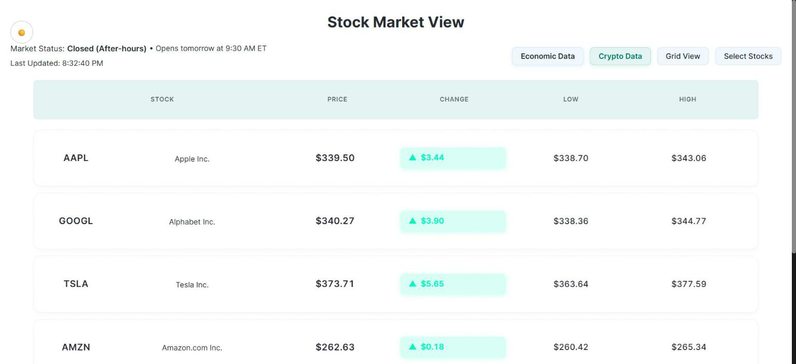

# StockTip

A real-time market dashboard that brings stock quotes, company fundamentals, crypto, economic indicators and AI-written analysis into one React app.

**[Live demo](https://shreyask06.github.io/stockTip/)**



> The dashboard calls third-party APIs from the browser and needs your own keys for live data. The crypto list falls back to generated mock data when its API call fails.

## Features

- **Stocks.** A searchable stock list and a detail view with company overview, earnings data and insider transactions.
- **Crypto.** A crypto list with exchange rates.
- **Economic indicators.** Macro data alongside the equities view.
- **Market news** and **AI-powered analysis** of a selected stock via OpenAI.
- **Charts** built with Recharts.

## Tech stack

React 18, React Router, Recharts, Axios, Finnhub and Financial Modeling Prep for market data, OpenAI for analysis. Deployed to GitHub Pages with `gh-pages`.

## Getting started

```bash
cd app
npm install
cp .env.example .env     # add your API keys
npm start                # http://localhost:3000
```

`.env` variables:

| Variable | Source |
|---|---|
| `REACT_APP_FINNHUB_API_KEY` | [finnhub.io](https://finnhub.io) |
| `REACT_APP_FMP_API_KEY` | [financialmodelingprep.com](https://financialmodelingprep.com) |
| `REACT_APP_OPENAI_API_KEY` | [platform.openai.com](https://platform.openai.com) |
| `REACT_APP_ALPHA_VANTAGE_API_KEY` (optional) | [alphavantage.co](https://www.alphavantage.co) |

**Security note:** every `REACT_APP_` variable is bundled into the public JavaScript. For anything beyond a personal demo, proxy these calls through your own server and keep the keys there.

## Scripts

| Command | What it does |
|---|---|
| `npm start` | Dev server with hot reload |
| `npm test` | Run the test runner |
| `npm run build` | Production build |
| `npm run deploy` | Build and publish to GitHub Pages |

## Project structure

```
app/src/
  App.js, StockList.js, StockDetail.js     stock views
  CryptoData.js, EconomicData.js           crypto and macro views
  components/                              overview, earnings, insiders, indicators
  services/, utils/                        API clients and helpers
  mockData.js, mockDataService.js          mock data used as a fallback
```

## Limitations

Market data comes from free-tier APIs with rate limits, and AI analysis is generated text, not investment advice.
